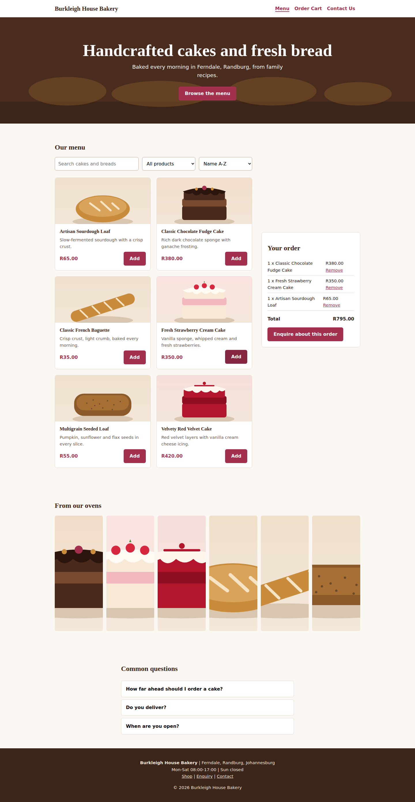
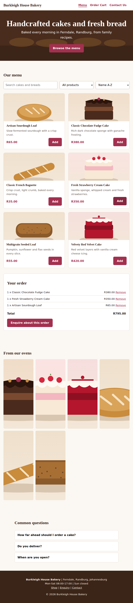
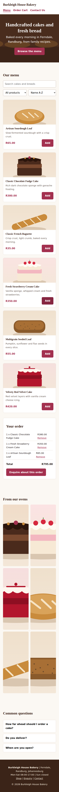
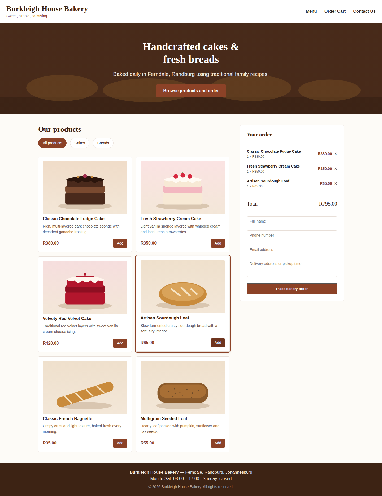
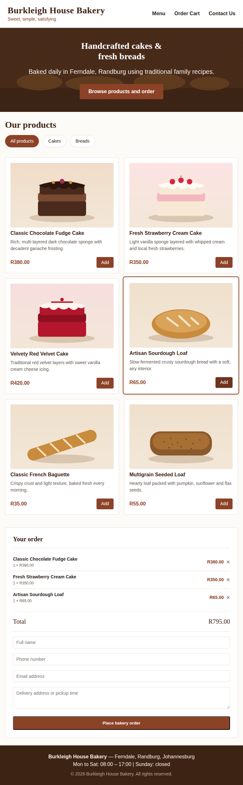
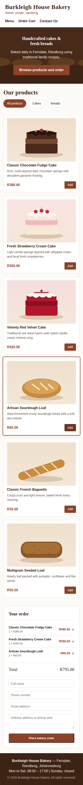

# Burkleigh House Bakery - WEDE5020 POE Part 3

A responsive website for a family bakery in Ferndale, Randburg, Johannesburg. Visitors can browse cakes and breads, build an order summary, send a product enquiry with an instant price and availability response, and contact the bakery.

- **Live site:** https://calm-sawine-f3c741.netlify.app
- **Repository:** https://github.com/ST10525017TharagePhuluso/burkleigh-house-bakery
- **Student number:** ST10525017

## Contents
1. [Project structure](#project-structure)
2. [Functionality](#functionality)
3. [Search engine optimisation](#search-engine-optimisation)
4. [Forms](#forms)
5. [Images](#images)
6. [Part 2 overview: CSS styling and responsive design](#part-2-overview-css-styling-and-responsive-design)
7. [Responsive design and testing screenshots](#responsive-design-and-testing-screenshots)
8. [Testing](#testing)
9. [Configuration](#configuration)
10. [Changelog](#changelog)
11. [References](#references)

## Project structure
```
index.html        Shop, gallery, FAQ
enquiry.html      Enquiry form (price and availability response, AJAX)
contact.html      Contact form (compiled email) and Leaflet map
404.html          Friendly not-found page
css/styles.css    All styling (responsive, reduced-motion aware)
js/script.js      All behaviour (jQuery 3.7.1 + Leaflet 1.9.4)
images/           Product photos (.jpg) and matching illustrations (.svg), see Images
screenshots/      Responsive design screenshots for Part 2 and Part 3
download-images.ps1, download-images.sh   One-off scripts that download the photos into images/
robots.txt, sitemap.xml, _headers
```

## Functionality
| Requirement | Where | How it works |
|---|---|---|
| Accordion | `index.html` FAQ | jQuery `slideDown`/`slideUp`; one panel open at a time; `aria-expanded` kept in sync |
| Modal | `index.html` | Click a product photo to open a `dialog` with price, lead time and an enquiry link; closes with Close, Esc or a click outside |
| Interactive map | `contact.html` | Leaflet + OpenStreetMap tiles, zoomable, marker with popup for the bakery |
| Animations/transitions | all pages | CSS page-load rise on the hero heading, hover lift on buttons and gallery photos, jQuery slide on the accordion; disabled when the user prefers reduced motion |
| Advanced DOM manipulation | `js/script.js` | Product cards, order summary, gallery, enquiry options, results and error messages are created and updated with jQuery DOM methods |
| Gallery with lightbox | `index.html` | Click any gallery photo for a larger view with caption, Previous/Next buttons, arrow-key navigation, Esc to close |
| Dynamic content | `index.html` | Product listings are generated from a JavaScript data array |
| Search, filter, sort | `index.html` | Live text search (matches name, description and category, so "bread" finds all breads), category filter, and sort by name or price; shows a message when nothing matches |

## Search engine optimisation
- **Keyword research:** target phrases are "bakery Randburg", "custom cakes Johannesburg", "sourdough Ferndale" and "fresh bread". They appear in titles, headings, descriptions and body text.
- **Title tags and meta descriptions:** unique for every page.
- **Meta keywords:** present on every page (search engines largely ignore them, but they are included to meet the brief).
- **Headings:** one `h1` per page, then `h2` and `h3` in order.
- **Images:** descriptive file names (for example `chocolate-fudge-cake.jpg`) and specific alt text on every image.
- **URLs and internal linking:** short lowercase URLs; header and footer link every page; the product modal links to the enquiry page.
- **Mobile-friendly:** viewport tag and a responsive layout that stacks below 800px.
- **Off-page and local SEO:** canonical links and Open Graph tags on every page, `Bakery` structured data (JSON-LD) with address and opening hours on the home page, and a map with the Ferndale, Randburg location. Backlink and social media plan: list the bakery on Google Business Profile, local Randburg directories and Facebook/Instagram, linking back to the live site.
- **robots.txt and sitemap.xml:** included, with the sitemap referenced from robots.txt.
- **Page speed:** local lightweight images with width/height set, lazy loading, two small own files, third-party libraries loaded at the end of the body, one font request with `display=swap`.
- **Security:** Content-Security-Policy and referrer policy in every page (including the 404 page), no inline `style` attributes, `_headers` (Netlify) for frame, content-type and permissions protection, all user text written with `.text()`, validated input, no secrets in the code.
- **Accessibility:** every form field and the search, filter and sort controls have a label (visually hidden where the design needs it), errors use `role="alert"`, dialogs have labels, keyboard focus is visible.

## Forms
- **Enquiry form (`enquiry.html`):** name, email, phone, product, quantity, date, collection or delivery. After validation it returns the cost (including the R60 delivery fee) and availability (2 days notice for cakes, 1 day for breads, closed Sundays), and submits with `$.ajax`.
- **Contact form (`contact.html`):** name, email, phone, message type and message. After validation it compiles an email, shows a preview and opens it addressed to the recipient set in the code.
- **Validation:** HTML5 attributes plus JavaScript: letters-only names, email format, South African phone numbers (`082 123 4567` or `+27...`), future dates, no Sundays, quantity 1-20, message 10-1000 characters. Errors appear under each field with `role="alert"` and the field is marked `aria-invalid`.

## Images
Each product has a real photo and a matching illustration. The site tries them in this order, so nothing is ever left broken:

1. **Local photo** in `images/` (for example `images/chocolate-fudge-cake.jpg`)
2. **The same photo from Unsplash**, used only if the local file is missing
3. **Local illustration** (`images/chocolate-fudge-cake.svg`), used only if both photos fail

The photos come from Unsplash. To store them locally, run `download-images.ps1` (Windows PowerShell) or `sh download-images.sh` once from the project folder, check that every line says `OK`, then commit the `images/` folder. The hero banner follows the same order (`images/fresh-seeded-bread-hero.jpg`, then Unsplash, then `images/bakery-counter-hero.svg`). You can replace any photo with your own by saving it under the same file name.

## Part 2 overview: CSS styling and responsive design
Part 2 built on the Part 1 HTML structure by adding a full external CSS stylesheet and making the site responsive for mobile and tablet devices.

- An external stylesheet (`style.css`) linked from `index.html` via `<link rel="stylesheet" href="style.css">`.
- A CSS reset (`*`, `*::before`, `*::after`) to normalise margin, padding and box-sizing across browsers.
- A base style layer using CSS custom properties (`:root` variables) for colour scheme, typography and spacing, so the whole site can be restyled from a small number of central values while taking advantage of the cascade with a minimum number of selectors.
- A typographic scale (heading font and body font, font-size variables) replacing the old `<font>` tag styling from Part 1.
- Layout styling for the header, hero section, shop layout (product grid and order panel) and footer, using flexbox and grid instead of table-based layout.
- Component styling for product cards, filter buttons (`.filter-btn` / `.filter-btn.active`), add/remove buttons, the order panel and form inputs.
- Responsive design using relative units (`rem`, `%`, flex and grid) and two breakpoints: `max-width: 768px` (tablet: shop layout stacks, hero padding reduced) and `max-width: 480px` (mobile: single-column product grid, header stacks, smaller headings).

Part 3 carries this forward in `css/styles.css` (single stylesheet shared by all pages, with the layout stacking at 800px and below).

## Responsive design and testing screenshots
All captures are full-page, taken in Chromium at the widths below, with three items added to the order summary to show the cart working. **The product images in these captures are the built-in illustration fallbacks**, because the captures were taken without internet access.

### Part 3 (`css/styles.css`)
**Desktop, 1440px wide** (two columns: products and order summary side by side)



**Tablet, 768px wide** (single column, order summary below the products)



**Phone, 390px wide** (single column, stacked navigation and full-width controls)



### Part 2 (`style.css`)
**Desktop, 1440px wide**



**Tablet, 768px wide**



**Phone, 390px wide**



## Testing
Tested in Chromium at 1440px, 768px and 390px widths. No sideways scrolling on the home, enquiry or contact page at any of the three widths, and no JavaScript errors on any page.

| Area | Test | Result |
|---|---|---|
| Search | "cake" returns 3, "bread" returns 3, a nonsense word shows the no-results message | Pass |
| Filter and sort | Breads filter returns 3; price low-to-high puts the baguette first; high-to-low puts the red velvet cake first | Pass |
| Order summary | Repeat items group with a quantity; total updates; Remove deletes the line | Pass |
| Modal | Opens on photo click; closes with Close, Esc and click outside | Pass |
| Accordion | Only one panel open at a time; `aria-expanded` stays in sync | Pass |
| Lightbox | Opens; Previous/Next and left/right arrow keys change the photo; Esc closes | Pass |
| Enquiry | Empty submit shows errors; Sunday rejected; a cake for tomorrow reports "too soon"; 2 red velvet cakes with delivery returns R900.00 and "confirmed" | Pass |
| Contact | Empty submit shows errors; valid message shows the email preview and a `mailto:` link; character counter updates | Pass |
| Layout | Two columns at 1440px; one column at 768px and 390px | Pass |
| Images | When no photo loads, every product image falls back to its illustration; none are broken | Pass |

The map and the form submission need internet access and the configuration below, so check them on the live site.

## Configuration
Two values must be set before the live site can send enquiries:

1. In `enquiry.html`, replace `YOUR_FORM_ID` in the form `action` with the ID from a free [Formspree](https://formspree.io) form. Until then the enquiry still shows the price and availability, but the automatic submission reports that it could not send.
2. In `contact.html`, replace `orders@YOUR-DOMAIN.co.za` in the hidden `recipient` field with the address that should receive messages.

If the site is deployed to Netlify instead of GitHub Pages, update the live-site URL in this README, `sitemap.xml`, `robots.txt` and the `<link rel="canonical">` tag on every page.

## Changelog
### Final check and corrections (2026-10-29)
| File | Change |
|---|---|
| css/styles.css, js/script.js, index.html | Restored the real cake and bread photos: local `.jpg` first, then the same Unsplash photo, then the illustration; hero banner uses the same order |
| index.html | Content-Security-Policy now allows Unsplash images |
| index.html, css/styles.css | Search, category and sort labels were hidden from screen readers (`hidden` attribute); now visually hidden with a `.sr` class instead |
| js/script.js | Search now also matches the category, so "bread" returns all three breads |
| js/script.js | Earliest enquiry date now uses the local date (the UTC date was a day behind early in the morning in South Africa) |
| js/script.js | Result and email boxes are shown reliably after validation |
| index.html, js/script.js | Gallery images now have width and height set, as the SEO section states |
| contact.html, enquiry.html, 404.html, css/styles.css | Removed inline `style` attributes, which the Content-Security-Policy blocks |
| enquiry.html, contact.html | Added Open Graph tags so every page has them |
| 404.html | Added Content-Security-Policy and referrer policy so every page has them |
| screenshots/, README.md | Added desktop, tablet and phone screenshots for Part 2 and Part 3, a testing table and a configuration section; removed setup notes and a draft commit list that did not belong in a final README |

### New in Part 3
| Date | File | Change |
|---|---|---|
| 2026-10-28 | js/script.js | Added dynamic product listing with search, category filter and sorting |
| 2026-10-28 | index.html | Added jQuery accordion FAQ and product modal |
| 2026-10-28 | index.html, js | Added gallery with lightbox, captions, Previous/Next and keyboard navigation |
| 2026-10-28 | contact.html | Added Leaflet map, validated form and compiled email |
| 2026-10-28 | enquiry.html | Added validated enquiry form, cost/availability response and AJAX submission |
| 2026-10-28 | all pages | Added unique titles, meta descriptions and keywords, canonical links, Open Graph tags and structured data |
| 2026-10-28 | images/, js, css | Added local images with descriptive file names and alt text, with an automatic illustration fallback and a download script |
| 2026-10-28 | robots.txt, sitemap.xml | Created crawler instructions and sitemap |
| 2026-10-28 | all pages, _headers | Added Content-Security-Policy, referrer policy and security headers |
| 2026-10-28 | 404.html | Added not-found page |

### Changes made based on feedback (corrections carried over from Parts 1 and 2)
| Date | File | Issue | Change made |
|---|---|---|---|
| 2026-10-28 | all pages | Layout built with tables and `<font>` tags | Rebuilt with semantic HTML (`header`, `nav`, `main`, `section`, `footer`) and one shared `css/styles.css` |
| 2026-10-28 | all pages | Navigation must keep the three Part 2 options | Navigation is Menu, Order Cart and Contact Us, linking to the product list, order summary and contact page; the enquiry page is reached from the order summary, product pop-up and footer |
| 2026-10-28 | all pages | Page not usable on phones | Added a responsive grid and flexible layout |
| 2026-10-28 | index.html, css | Hero text hard to read over the photo | Added a dark overlay on the hero background |
| 2026-10-28 | index.html, js | Baguette and loaf shared the same image | Every product has its own image |
| 2026-10-28 | index.html, js | Cart added the same item as separate lines | Cart groups items with quantities and a Remove button |
| 2026-10-28 | index.html, js | Order form did not capture or process data | Replaced with a validated enquiry form that returns cost and availability |
| 2026-10-28 | all pages | Buttons had no styling or focus state | Added button, focus and hover styles |

### Earlier parts
- **Part 2:** external stylesheet, CSS reset, design tokens, typographic scale, flexbox/grid layout, component styles and responsive breakpoints (see the Part 2 overview above).
- **Part 1:** initial HTML structure for the homepage, product menu, order panel and footer, with product data and cart logic in JavaScript.

## References
Format: Harvard (adjust to your institution's guide if different).
- Google (2026) *SEO starter guide*. Available at: https://developers.google.com/search/docs/fundamentals/seo-starter-guide (Accessed: 28 October 2026).
- Google (2026) *Google Fonts*. Available at: https://fonts.google.com (Accessed: 29 October 2026).
- jQuery Foundation (2024) *jQuery 3.7.1 documentation*. Available at: https://api.jquery.com (Accessed: 28 October 2026).
- Leaflet (2023) *Leaflet 1.9.4 documentation*. Available at: https://leafletjs.com/reference.html (Accessed: 28 October 2026).
- Mozilla (2026) *HTML dialog element*. Available at: https://developer.mozilla.org/en-US/docs/Web/HTML/Element/dialog (Accessed: 28 October 2026).
- Mozilla (2026) *Client-side form validation*. Available at: https://developer.mozilla.org/en-US/docs/Learn_web_development/Extensions/Forms/Form_validation (Accessed: 28 October 2026).
- OpenStreetMap contributors (2026) *OpenStreetMap*. Available at: https://www.openstreetmap.org (Accessed: 28 October 2026).
- Formspree (2026) *Formspree documentation*. Available at: https://help.formspree.io (Accessed: 28 October 2026).
- Netlify (2026) *Custom headers*. Available at: https://docs.netlify.com/manage/routing/headers (Accessed: 28 October 2026).
- Unsplash (2026) *Unsplash photos*. Available at: https://unsplash.com (Accessed: 29 October 2026).

## Submission
GitHub repository link submitted via Arc as required. Latest work pushed to the remote repository: https://github.com/ST10525017TharagePhuluso/burkleigh-house-bakery
